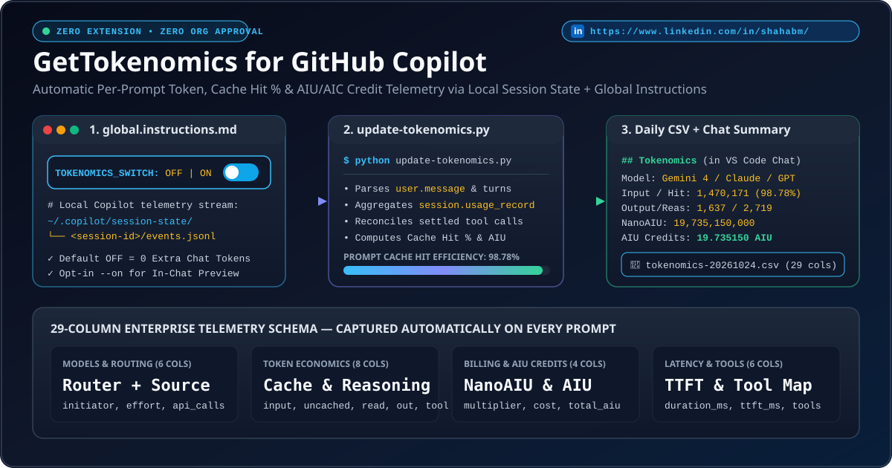
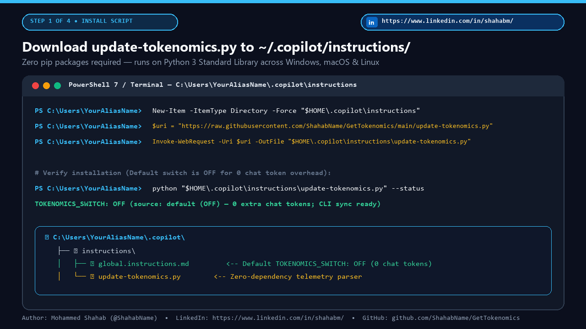
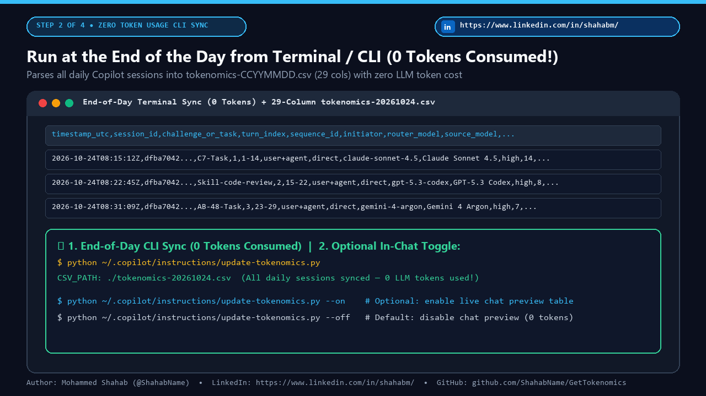
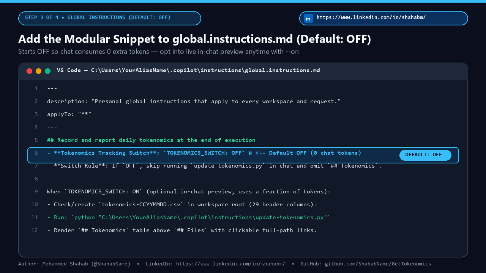
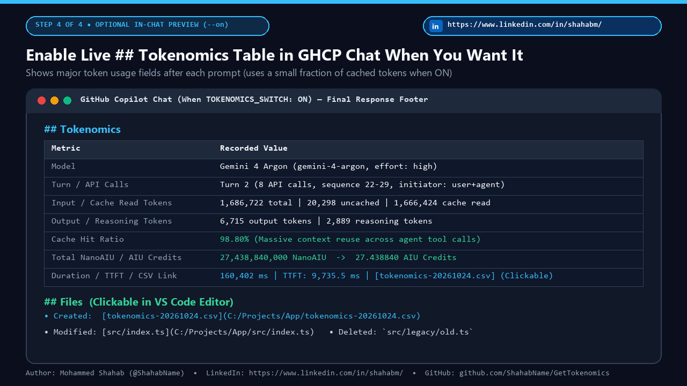

# ⚡ GetTokenomics — Agentic AI Tokenomics, Tracking Tokens, Prompt Cache & AIU Credit Telemetry for GitHub Copilot

[](LICENSE)
[-38bdf8.svg)](update-tokenomics.py)
[](#why-gettokenomics)
[](#keywords--search-tags)
[](https://shahabname.github.io/GetTokenomics/)
[](https://www.linkedin.com/in/shahabm/)

> **Simple. Powerful. Accidental Discovery for Agentic AI Tokenomics & Tracking Tokens.**  
> Track every GitHub Copilot Chat & Agent Mode prompt's **exact model routing, input tokens, uncached tokens, cache-read tokens, output tokens, reasoning tokens, prompt cache hit ratio %, NanoAIU, AIU/AIC credits, TTFT latency, and tool invocations** into a daily 29-column CSV (`tokenomics-CCYYMMDD.csv`) — **consuming 0 extra LLM tokens by default** when synced from your terminal/CLI at the end of the day, with an optional `TOKENOMICS_SWITCH: ON` toggle whenever you want a live `## Tokenomics` preview table inside GitHub Copilot Chat.

🌐 **Live Interactive Website & Setup Guide:** [**https://shahabname.github.io/GetTokenomics/**](https://shahabname.github.io/GetTokenomics/)  
💼 **Connect with the Author on LinkedIn:** [**https://www.linkedin.com/in/shahabm/**](https://www.linkedin.com/in/shahabm/)



---

## 💡 Why GetTokenomics?

Most developers and enterprise teams using Agentic AI have no visibility into what happens under the hood of a multi-step prompt:
* Which **router model** and **source model** actually served the turn?
* How many **API calls** and **sub-agent sequences** did a single prompt trigger?
* How much of your 1.5M+ token context came from **prompt cache reads** (`94%–99%`) vs. fresh uncached input tokens?
* How many **NanoAIU / AIU (AIC) credits** and **reasoning tokens** did that task consume?

**GetTokenomics** solves this using two things that already exist on your machine:
1. **Your local Copilot session event stream** (`~/.copilot/session-state/<session-id>/events.jsonl`)
2. **A single zero-dependency Python script** ([`update-tokenomics.py`](update-tokenomics.py)) that you can run from your terminal at the end of the day (**0 tokens consumed**), paired with an optional **`TOKENOMICS_SWITCH: OFF | ON`** block in `~/.copilot/instructions/global.instructions.md` (**`OFF` by default** so you decide if and when you want in-chat preview tables).

| Capability | Traditional Telemetry Tools | **GetTokenomics** |
|---|---|---|
| **Token Overhead in Default Mode** | Varies / proxy overhead | ✅ **0 Extra Tokens (End-of-Day Terminal / CLI Sync)** |
| **In-Chat Live Preview Table** | Requires custom extension | ✅ **Opt-in via `--on` (`TOKENOMICS_SWITCH: ON`, uses a fraction of cached tokens)** |
| **VS Code Extension Installation** | Requires marketplace extension | ✅ **None required** |
| **Enterprise / Org Admin Approval** | Requires org API keys or OAuth app | ✅ **Zero permissions needed** |
| **Python / Node Dependencies** | Requires `pip install` or `npm install` | ✅ **100% Python 3 Standard Library** |
| **Multi-Turn Settlement Accuracy** | Misses final tool-call usage | ✅ **Auto-reconciles settled turns across all daily sessions** |

---

## 🚀 2-Minute Setup Guide — Zero Token Usage First (With Optional In-Chat Preview)

### Step 1: Download `update-tokenomics.py` into `~/.copilot/instructions/`

Open **PowerShell** (Windows) or **Terminal** (macOS/Linux) and download [`update-tokenomics.py`](update-tokenomics.py) into your user `.copilot/instructions` directory:

**Windows (PowerShell):**
```powershell
New-Item -ItemType Directory -Force "$HOME\.copilot\instructions" | Out-Null
Invoke-WebRequest -Uri "https://raw.githubusercontent.com/ShahabName/GetTokenomics/main/update-tokenomics.py" `
  -OutFile "$HOME\.copilot\instructions\update-tokenomics.py"
```

**macOS / Linux (Bash / Zsh):**
```bash
mkdir -p "$HOME/.copilot/instructions"
curl -fsSL https://raw.githubusercontent.com/ShahabName/GetTokenomics/main/update-tokenomics.py \
  -o "$HOME/.copilot/instructions/update-tokenomics.py"
```



---

### Step 2: Capture Tokenomics from Terminal / CLI at the End of the Day (Zero Token Usage — Default!)

Because GitHub Copilot automatically writes session telemetry locally to `~/.copilot/session-state/<session-id>/events.jsonl`, **you do not need to spend any LLM tokens to capture your daily tokenomics**.

Work normally in VS Code all day. Whenever you want to update your daily `tokenomics-CCYYMMDD.csv` (for example, at the end of the day or after finishing a feature), simply run the script from your terminal in your project directory:

**Windows (PowerShell):**
```powershell
# Parses all Copilot sessions from today and updates tokenomics-CCYYMMDD.csv (0 tokens consumed!)
python "$HOME\.copilot\instructions\update-tokenomics.py"

# Optional: also print the latest turn's ## Tokenomics Markdown table right in your terminal
python "$HOME\.copilot\instructions\update-tokenomics.py" --markdown
```

**macOS / Linux (Bash / Zsh):**
```bash
# Parses all Copilot sessions from today and updates tokenomics-CCYYMMDD.csv (0 tokens consumed!)
python3 "$HOME/.copilot/instructions/update-tokenomics.py"

# Optional: also print the latest turn's ## Tokenomics Markdown table right in your terminal
python3 "$HOME/.copilot/instructions/update-tokenomics.py" --markdown
```

* **Tokens Consumed:** **`0` tokens (`0.00 AIU`)** — runs 100% locally offline against `events.jsonl`.



---

### Step 3: Add the Modular Instructions Block to `global.instructions.md` (Default: `OFF`)

To prepare your IDE so you can toggle live in-chat token usage display `ON` or `OFF` whenever you choose, open (or create) your personal global instructions file at:
* **Windows:** `C:\Users\YourAliasName\.copilot\instructions\global.instructions.md`
* **macOS / Linux:** `~/.copilot/instructions/global.instructions.md`

Paste the modular snippet below (also available in [`instructions/global-instructions-snippet.md`](instructions/global-instructions-snippet.md) or [`instructions/tokenomics.instructions.md`](instructions/tokenomics.instructions.md)). Notice that **`TOKENOMICS_SWITCH` is set to `OFF` by default** on first-time deployment so it consumes **zero tokens** in chat until you explicitly decide to turn it `ON`:

````markdown
## Record and report daily tokenomics at the end of execution

- **Tokenomics Tracking Switch**: `TOKENOMICS_SWITCH: OFF` *(Default: `OFF` for zero token usage in chat — run `python "C:\Users\YourAliasName\.copilot\instructions\update-tokenomics.py"` in your terminal at the end of the day to update `tokenomics-CCYYMMDD.csv` with 0 tokens consumed. Change to `ON` or run `--on` if you want a live `## Tokenomics` preview table in GHCP Chat at the end of each prompt, which consumes a small fraction of tokens)*
- **Switch Rule**: Before recording or reporting tokenomics, check `TOKENOMICS_SWITCH` above. If it is set to `OFF`, skip running `update-tokenomics.py`, do not create or modify `tokenomics-CCYYMMDD.csv` during the chat turn, and omit the `## Tokenomics` section from the response.

When `TOKENOMICS_SWITCH: ON`, at the end of every prompt or task execution, record the prompt's tokenomics and AIC/AIU consumption in today's daily CSV file in the workspace root (`tokenomics-CCYYMMDD.csv`, where `CCYYMMDD` is the current date in `YYYYMMDD` format, such as `tokenomics-20261024.csv`) and display a summary in the final response.

- Check whether `tokenomics-CCYYMMDD.csv` exists in the current workspace root directory with the following 29 header columns:
  ```csv
  timestamp_utc,session_id,challenge_or_task,turn_index,sequence_id,initiator,router_model,source_model,model_display_name,reasoning_effort,api_calls_count,user_prompt_multiplier,total_request_multiplier_cost,total_input_tokens,uncached_input_tokens,cache_read_tokens,cache_write_tokens,output_tokens,reasoning_tokens,tool_schema_tokens,cache_hit_ratio_pct,total_nano_aiu,total_aiu_credits,duration_ms,ttft_ms,tools_invoked,finish_reason,ai_credits_status,prompt_summary
  ```
- If `tokenomics-CCYYMMDD.csv` does not exist yet, create it with the 29 header columns above.
- If `tokenomics-CCYYMMDD.csv` already exists, append the latest prompt turn tokenomics data from `C:\Users\YourAliasName\.copilot\session-state\<session-id>\events.jsonl` (and refresh any previous turn in the session whose final tool-call usage settled after the prior turn). You can run `python "C:\Users\YourAliasName\.copilot\instructions\update-tokenomics.py"` to perform this check, creation, and append automatically.
- At the end of every prompt response (immediately above `## Files`), include a `## Tokenomics` section showing the tokenomics usage data recorded in `tokenomics-CCYYMMDD.csv` (model, API calls, input/cache/output/reasoning tokens, cache hit %, total NanoAIU, total AIU/AIC credits, duration, and a clickable link to `[tokenomics-CCYYMMDD.csv](C:/full/absolute/path/to/tokenomics-CCYYMMDD.csv)` using its absolute filesystem path with `/` separators).

## Preserve default VS Code chat output

- Recording tokenomics (`update-tokenomics.py`) and appending `## Tokenomics` and `## Files` are strictly additive and must **never** replace, suppress, or alter VS Code's normal chat response or built-in tool defaults.
- Always display the complete user-facing explanation, analysis, or report in the chat response, with `## Tokenomics` and `## Files` appended at the end.
````



---

### Step 4: Optional — Enable Live `## Tokenomics` Preview Table in GHCP Chat

Want to see a live **`## Tokenomics` summary table** of major token usage fields (`Model`, `Turn / API Calls`, `Input / Uncached / Cache Read Tokens`, `Output / Reasoning Tokens`, `Cache Hit Ratio %`, `Total NanoAIU`, `Total AIU / AIC Credits`, `Duration / TTFT`, and a clickable CSV link) at the end of every prompt right inside **GitHub Copilot Chat**?

> 💡 **Token Usage Note:** Enabling in-chat preview (`TOKENOMICS_SWITCH: ON`) instructs the Copilot agent to run `update-tokenomics.py` via its terminal tool at the end of the turn and render the Markdown table in chat. This consumes **a small fraction of tokens** per prompt (1 extra agent tool round-trip where ~90%–99% of context is served from prompt cache + ~200 output tokens to render the table, with **0 extra user prompt multiplier**). Keep it `OFF` for 0-token CLI capture, or turn it `ON` whenever you want live in-chat visibility!

You can turn live in-chat preview **`ON`** (or back **`OFF`**) anytime:

1. **Use the built-in CLI switch:**
   ```bash
   # Enable live ## Tokenomics preview table in GHCP Chat
   python "$HOME/.copilot/instructions/update-tokenomics.py" --on

   # Disable in-chat preview (back to default 0-token CLI-only mode)
   python "$HOME/.copilot/instructions/update-tokenomics.py" --off

   # Check current switch status (OFF by default)
   python "$HOME/.copilot/instructions/update-tokenomics.py" --status
   ```
2. **Edit `global.instructions.md` directly:**
   Change `TOKENOMICS_SWITCH: OFF` to `TOKENOMICS_SWITCH: ON`.
3. **Environment variable override:**
   Set `GETTOKENOMICS_ENABLED=1` (enable) or `GETTOKENOMICS_ENABLED=0` (disable).



---

## 📊 The 29-Column Tokenomics CSV Schema

Every row in `tokenomics-CCYYMMDD.csv` captures one complete prompt turn (including all autonomous tool calls and sub-agent invocations within that turn):

| # | Column Name | Category | Description |
|---|---|---|---|
| 1 | `timestamp_utc` | Identity & Context | ISO-8601 UTC timestamp when the prompt turn started |
| 2 | `session_id` | Identity & Context | Unique Copilot session UUID (`~/.copilot/session-state/<session-id>`) |
| 3 | `challenge_or_task` | Identity & Context | Auto-inferred task/challenge/issue/skill slug (e.g., `C7-Task`, `AB-48-Task`, `Skill-code-review`) |
| 4 | `turn_index` | Identity & Context | 1-based turn number within the session |
| 5 | `sequence_id` | Identity & Context | Accounting sequence span across main and sub-agent calls (e.g., `1-20+sub(1-4)`) |
| 6 | `initiator` | Routing & Model | Call initiators involved in the turn (`user`, `user+agent`, `user+agent+sub-agent`) |
| 7 | `router_model` | Routing & Model | Synthetic router model if routed (e.g., `direct`, `hydrafusion`) |
| 8 | `source_model` | Routing & Model | Underlying model ID (e.g., `claude-sonnet-4.5`, `gpt-5.3-codex`, `gemini-4-argon`) |
| 9 | `model_display_name` | Routing & Model | Human-friendly model display name |
| 10 | `reasoning_effort` | Routing & Model | Configured reasoning effort (`low`, `medium`, `high`, `xhigh`, `max`) |
| 11 | `api_calls_count` | Routing & Model | Total LLM API calls executed during the turn |
| 12 | `user_prompt_multiplier` | Billing & Credits | User-initiated prompt billing multiplier |
| 13 | `total_request_multiplier_cost` | Billing & Credits | Sum of request multipliers across all API calls in the turn |
| 14 | `total_input_tokens` | Token Economics | Cumulative input tokens processed across all calls in the turn |
| 15 | `uncached_input_tokens` | Token Economics | Fresh uncached input tokens billed at full input weight |
| 16 | `cache_read_tokens` | Token Economics | Input tokens served directly from the prompt cache |
| 17 | `cache_write_tokens` | Token Economics | Tokens written into the prompt cache |
| 18 | `output_tokens` | Token Economics | Generated completion/output tokens |
| 19 | `reasoning_tokens` | Token Economics | Internal chain-of-thought / reasoning tokens consumed |
| 20 | `tool_schema_tokens` | Token Economics | Peak token footprint of declared MCP and built-in tool schemas |
| 21 | `cache_hit_ratio_pct` | Token Economics | Percentage of `total_input_tokens` satisfied by `cache_read_tokens` (`0.00`–`100.00%`) |
| 22 | `total_nano_aiu` | Billing & Credits | Raw consumption in NanoAIU (`10^-9` AIU) from `copilotUsage.totalNanoAiu` |
| 23 | `total_aiu_credits` | Billing & Credits | Total AIU / AIC credits (`total_nano_aiu / 1,000,000,000`) |
| 24 | `duration_ms` | Latency & Tools | Cumulative LLM execution time in milliseconds across the turn |
| 25 | `ttft_ms` | Latency & Tools | Time-To-First-Token (ms) on the initial user-initiated call |
| 26 | `tools_invoked` | Latency & Tools | Semicolon-delimited histogram of tools called (e.g., `edit:3;powershell:2;view:9`) |
| 27 | `finish_reason` | Latency & Tools | Final turn completion reason (`stop`, `tool_calls`) |
| 28 | `ai_credits_status` | Billing & Credits | Credit accounting settlement status (`complete`) |
| 29 | `prompt_summary` | Identity & Context | Cleaned 240-character summary of the user's prompt (XML wrappers stripped) |

---

## 📁 Repository Structure

```text
GetTokenomics/
├── update-tokenomics.py                       # Zero-dependency Python 3 telemetry parser & CLI switch
├── instructions/
│   ├── tokenomics.instructions.md             # Standalone drop-in .instructions.md file (with ON/OFF switch)
│   └── global-instructions-snippet.md         # Modular snippet to paste into global.instructions.md
├── examples/
│   └── sample-tokenomics-20261024.csv         # Realistic 29-column sample CSV output
├── docs/                                      # GitHub Pages Static Website (https://shahabname.github.io/GetTokenomics/)
│   ├── index.html                             # Interactive setup guide, path customizer & schema explorer
│   └── assets/
│       ├── gettokenomics-hero-animated.svg    # Animated vector architecture diagram
│       ├── gettokenomics-demo.gif             # 4-frame animated walkthrough GIF
│       └── screenshots/                       # Step 1-4 high-resolution setup screenshots
├── linkedin/                                  # Ready-to-share LinkedIn Article, Post & Animated Media
│   ├── LINKEDIN_ARTICLE.md                    # Full LinkedIn long-form article
│   ├── LINKEDIN_POST.md                       # Short punchy LinkedIn post with hashtags
│   ├── gettokenomics-demo.gif                 # Animated GIF for LinkedIn post/article upload
│   └── gettokenomics-hero-animated.svg        # Animated SVG banner
├── tests/
│   └── test_update_tokenomics.py              # Automated unit test suite
├── CONTRIBUTING.md
├── CODE_OF_CONDUCT.md
├── CHANGELOG.md
└── LICENSE                                    # MIT License
```

---

## 🧪 Running Tests

```bash
python -m unittest discover -s tests -v
```

---

## 🔍 Keywords, Use Cases & Search Tags

**GetTokenomics** is built for developers, AI engineers, FinOps teams, and engineering leaders searching for:

* **Agentic AI & Multi-Agent Telemetry**: *Agentic AI tokenomics, Agentic AI token tracking, multi-agent token consumption, sub-agent sequence tracking, tool-call token footprint, MCP server schema token overhead.*
* **Tracking Tokens & LLM Token Usage**: *Tracking tokens in VS Code, GitHub Copilot token counter, LLM token tracker, input vs. output tokens, reasoning tokens, chain-of-thought token usage, prompt token analytics.*
* **Prompt Caching & Token Optimization**: *Prompt cache hit ratio, cached vs. uncached input tokens, context window optimization, reducing LLM token waste, cache read telemetry.*
* **AI FinOps & Credit Accounting**: *AIU credits, AIC credits, NanoAIU tracking, request billing multipliers, LLM cost observability, daily AI tokenomics CSV export for Excel, Power BI, and Pandas.*

`#AgenticAI` `#Tokenomics` `#TrackingTokens` `#TokenTracking` `#TokenUsage` `#LLMObservability` `#AIFinOps` `#GitHubCopilot` `#PromptCaching` `#TokenOptimization` `#VSCode` `#AIEngineering`

---

## 📄 License & Author

Released under the [MIT License](LICENSE).

* **Author:** **Mohammed Shahab**
* **GitHub:** [@ShahabName](https://github.com/ShahabName)
* **LinkedIn:** [https://www.linkedin.com/in/shahabm/](https://www.linkedin.com/in/shahabm/)
* **Website:** [https://shahabname.github.io/GetTokenomics/](https://shahabname.github.io/GetTokenomics/)
